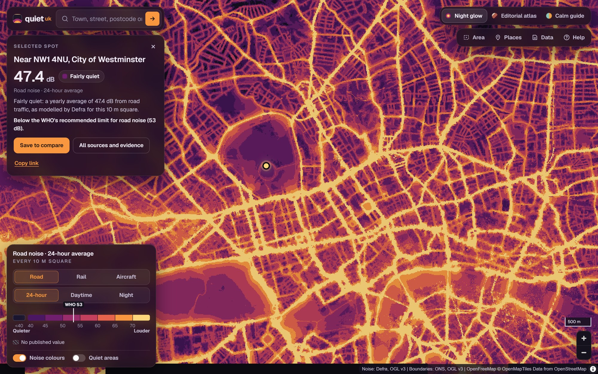
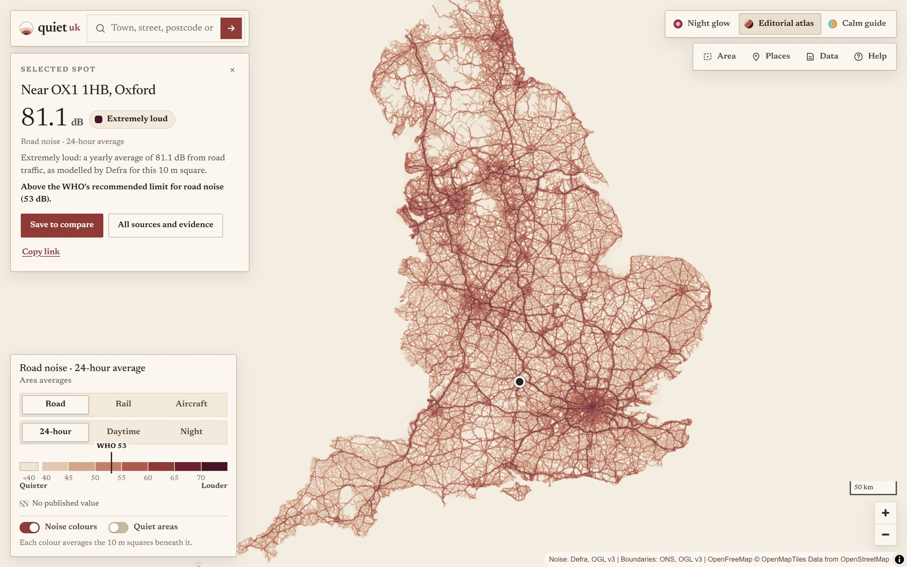

# Quiet UK

**A map of how loud transport noise is, everywhere in England, down to every 10 m square.**



Quiet UK puts the official Defra Round 4 noise maps for road, rail and aircraft into
one map you can search and click. Every value comes straight from Defra's 10 m
grids, so you can see how loud a street, a park or a house is, in decibels and in
plain words, compared with the World Health Organization's guideline. It is for
anyone choosing a home, planning a walk or studying noise, and every number links
back to its source.



## What you can do

- **Check any spot.** Search for a town, street or postcode, or click the map. You
  get the level for that 10 m square, a plain-language band (from *very quiet* to
  *extremely loud*), and how it compares with the WHO's guideline.
- **Switch source and time.** Road, rail or aircraft; 24-hour average, daytime or
  night.
- **See the whole country.** Zoomed out, colours show averages of the 10 m squares
  beneath them, and **Quiet areas** shows how much of each 5 km hexagon is very
  quiet.
- **Summarise an area.** Draw a box of up to 100 km² to see how its road or rail
  noise divides between the bands, and where its quietest and loudest spots are.
- **Compare places.** Save up to three spots and see them side by side.
- **Get the evidence.** **All sources and evidence** shows every indicator for the
  spot, with the exact values, versions and downloads that researchers need.
- **Choose a look.** *Night glow*, *Editorial atlas* or *Calm guide*. Each follows
  your device's light or dark mode and works on phones.

Where Defra published a zero, the map shows **under 40 dB** (under 35 dB at night).
Defra has confirmed in writing that a zero is a calculated level below the cutoff
([Defra's reply](notes/DEFRA_DATA_REQUEST_2026-10-03.md#provider-reply)). Where
Defra published nothing, the map says so rather than guessing.

## Run it

Quiet UK runs on your own computer. On Windows, double-click
**Launch Quiet UK.cmd** in this folder. It starts the local server, waits until it
is ready and opens your browser at **http://127.0.0.1:8766/**. Repeated launches
reuse the running server, and an older Quiet UK server is replaced automatically.
Startup logs are saved under `artifacts/launcher`.

Or start it from a terminal in this folder:

```powershell
.\.venv\Scripts\python.exe scripts\29_serve_explorer.py
```

The noise data itself is not in Git: the downloaded grids and built map files under
`artifacts/` are far too large for it. [How the England map works](notes/ENGLAND_MAP.md)
lists the scripts that download and build each part, and how each is checked.

## Where the data comes from

| Data | Publisher | Licence |
|---|---|---|
| Road, rail and aircraft noise, Round 4 (road and rail describe 2021; Defra gives no year for aircraft) | Defra | Open Government Licence v3; Crown copyright |
| Country boundaries (December 2025) | Office for National Statistics | Open Government Licence v3; contains OS data © Crown copyright and database right 2025 |
| Place names and postcodes (OS Open Names) | Ordnance Survey | Open Government Licence v3; contains OS data © Crown copyright and database right 2026 |
| Basemap | OpenFreeMap, OpenMapTiles and OpenStreetMap contributors | ODbL (map data) |
| Fonts: Geist, Newsreader, Figtree | Their authors, via Fontsource | SIL Open Font License 1.1 (licences in `explorer/fonts`) |

Place suggestions come from a local copy of OS Open Names. Only a search you send on
with **Search OpenStreetMap** goes to Nominatim. Coordinates you type and every
noise lookup stay on your computer, and there are no analytics. The basemap needs
internet access to OpenFreeMap.

## Status

| Done | Still ahead |
|---|---|
| England-wide 10 m map for road, rail and aircraft | Wales, Scotland and Northern Ireland ([data requests](notes/PUBLISHER_REQUESTS_WALES_SCOTLAND_NI_2026-11-08.md)) |
| Search, area summaries, saved comparisons and evidence downloads | Defra's combined transport map, once Defra publishes it |
| Explicit unknown states, source scope and aircraft limitations | Defensible distinctions between places below the 40 dB cutoff |
| Versioned, checksum-verified data releases | A public website (today it runs only on your own computer) |

This is an exploratory product built on official models. Its values are Defra's
calculated levels, not measurements, and it is not an independently validated
exposure study.

**Start here:** [how the England map works](notes/ENGLAND_MAP.md),
[active roadmap](notes/ACTIVE_ROADMAP.md),
[research data contract](notes/RESEARCH_DATA_CONTRACT.md),
[stocktake against the Opus review](notes/PROJECT_STOCKTAKE_2026-09-28.md).
The 18 September product review and older phase reports are historical evidence;
the active roadmap is the current delivery plan.

## Verify a source-only checkout

The default tests need no downloaded noise data or running app. In a fresh Python
3.12 or 3.14 virtual environment, run from the repository root:

```text
python -m pip install -e ".[dev]"
python -m pip check
python -m pytest -q -rs --strict-markers
```

Windows 3.14 also has an exact dependency lock. The default suite builds tiny
synthetic datasets and uses checked-in, byte-preserved Defra fixtures. Three
production-release checks are explicitly deselected; to run those against an
existing data checkout, use `python -m pytest --run-release-checks -m release_data`.
Missing release inputs then fail clearly rather than silently skipping.
See [verification setup and scope](notes/REPRODUCIBLE_ENVIRONMENT.md#source-only-verification).

## Project history

- **5 November 2026:** all of England at 10 m. Every Defra Round 4 road, rail and
  aircraft grid for England was downloaded, checked and mapped (1,495 squares of
  10 km, 13,455 rasters).
- **6 November 2026:** the page became map-first, with three looks, a zoomed-out
  overview of area averages, the **Quiet areas** hexagons and the ONS country
  boundary, which keeps Defra's "no data" squares outside England from being drawn
  (the stored data is unchanged).
- **7 November 2026:** place suggestions as you type, named spots and the **Area**
  tool.
- **8 November 2026:** research into Wales, Scotland and Northern Ireland, and draft
  requests to their publishers.
- **2 October 2026 (earlier phase):** a local 10 m regional explorer for a
  100 × 50 km Oxford–London area, described below.

## The Oxford–London explorer and earlier work

**Earlier phase, 2 October 2026:** a working local 10 m regional explorer with
coverage outlines, source/time controls, place and coordinate search, keyboard
point inspection, saved comparisons and evidence downloads. It runs independently
of the optional historical England-wide 100 m overview. Wider UK noise coverage
is not yet implemented. This is an exploratory product, not an independently
validated research exposure release.

The **10 m explorer** contains a continuous 100 × 50 km Oxford–London footprint
(**5,000 km²**), including Heathrow, Oxford and the Chilterns. Its 50 cores
contain 450 road/rail/aircraft indicator rasters, with day/night/Lden controls,
place search, comparisons and an evidence bundle. This is downloaded coverage,
not a claim that every source has a reported value everywhere.
[Current release and verification](notes/OXFORD_LONDON_EXPANSION.md).

The latest local interpretation separates zero-coded unknowns from missing cells,
keeps aircraft cutoffs explicitly unknown, and warns when aircraft evidence is
excluded from a road/rail view. Original source values are unchanged.
[Evidence meanings and verification](notes/EVIDENCE_SEMANTICS.md).

**Data first, then evaluated estimates:** the optional **Recorded sound samples**
panel now provides 632 distinct short recordings at 11 documented London sites,
associated with 2019 surveys. It shows historical mixed-sound sample ranges,
durations, approximate positions, attribution and a separate evidence download.
These are not annual transport values or present-day predictions. The first
offline gap experiment profiles the installed road grids and evaluates whole
reported patches; it does not fill unknown cells.
[Delivery, qualification and results](notes/DATA_FIRST_DELIVERY_2026-10-02.md).

The [provider extraction audit](notes/PROVIDER_ENCODING_AND_EXTRACTION_AUDIT.md)
now replays offline from checked-in captures. Successful interior checks agree;
coverage-edge changes and unavailable protocol comparisons remain explicit.
Defra has since defined zero (calculated, below the cutoff) and nodata. The
England map applies this as evidence contract v2. Older releases keep v1, where
zero is unknown.

The England map has its own saved places and comparison, described in
[the map note](notes/ENGLAND_MAP.md#interface). In the Oxford–London explorer
(`/pilot`), select a point and **Add to comparison**. Save and name up
to three places, then **Compare places** to see all nine source/time indicators
side by side. Places persist in your browser; values are re-read from verified
originals. Download exact observations as CSV or JSON, or copy a release-specific
local comparison link. [Comparison behaviour and evidence](notes/PLACE_COMPARISON.md).

## Launcher and serving details

Open **http://127.0.0.1:8766/**. The England map is the home page when it is
installed. It follows the device's light or dark mode and works on phones. The
Oxford–London explorer is at **/pilot**, and is the home page when only a regional
release is installed. There, **Show all areas** reveals its coverage;
**Inspect map centre** supports keyboard use. The selected source/time value is
shown first, with the nine-indicator table under **All sources and time indicators**.
View links preserve the source, metric, point, camera, overlay visibility and release.
Recording links also preserve the selected site and recording release. The launcher
discovers `artifacts/recorded_sound_v3` when installed; use `--observations PATH`
for another qualified recording release.

To reproduce the optional recording layer and gap evaluation:

```text
python scripts/37_acquire_independent_evidence.py
python scripts/38_build_independent_observations.py
python scripts/38_build_independent_observations.py --verify
python scripts/39_evaluate_gap_baselines.py
```

The first command downloads about 7.2 MB from a pinned, openly licensed Zenodo
record; it excludes large audio archives. The builder requires a new output
directory. Gap evaluation requires the research extra and the installed
Oxford–London source release; it runs offline and preserves all native rasters.

A fresh source checkout plus an extracted regional evidence ZIP is sufficient:

```text
python scripts/29_serve_explorer.py --regional-only --pilot PATH_TO_EXTRACTED_BUNDLE
```

Use the directory containing `manifest.json`. No historical catalogue, mask or
national raster is needed in this mode. The source checkout itself contains test
fixtures, not the regional scientific release: obtain the existing **Download data
& evidence** ZIP from a data-equipped installation, or follow the regional
acquisition instructions below. The normal launcher discovers the standard local
`artifacts/oxford_london_map_v1` first, then `tiled_map_v2`, `source_regions_v2`,
`source_regions_v1` or `source_pilot_v1` under `artifacts/`.

When all historical inputs are installed, normal startup also enables the
explicit **Historical overview** link at `/overview`. Its construction and Lden
meaning are labelled separately; returning restores the detailed selection.
Existing national links at `/#map=…` continue to open that overview when available.
With only historical data installed, the overview remains the home page.

Startup verifies existing releases; it no longer implicitly builds national data.
Use `--build-only` explicitly to build/verify a historical display from the original
catalogue, mask and tiles. Incomplete or incompatible installed releases are not
repaired silently. Use a new `--display` destination for a new display generation.

Regional startup makes a private, checksum-verified copy in the operating-system
temporary directory. The running app stays pinned to those bytes if the original
folder changes; restart to load another release. A maximum of 512 raster readers
are reused with exclusive access. The serving CLI caps the GDAL pixel cache at
128 MiB; that is not a bound on total process memory. Evidence ZIPs are built once on disk and streamed,
with at most two simultaneous downloads. Normal shutdown removes the private copy
and ZIP; forced termination may leave a `quiet-uk-serving-*` temporary directory.
Allow about **6.14 GB** extra disk space for the current copied release and ZIP.
The latest local five-client benchmark measured 47 s verified startup, point
p95 140 ms, comparison p95 238 ms, and 781 MiB peak process memory through export.
The first ZIP took 70 s and was 742 MB. These measurements do not establish public
or national capacity. Historical overview serving is unchanged. See
[serving isolation](notes/REGIONAL_SERVING.md) and
[current measurements and limitations](notes/OXFORD_LONDON_EXPANSION.md).

Git tracks the application, tests, dependency lock and documentation. Downloaded
rasters, generated `artifacts/` (including catalogues, display assets and evidence
bundles), local configuration and Python environments remain outside Git. Updating
or cloning this repository is not a backup or restoration of those data products.
See [environment setup](notes/REPRODUCIBLE_ENVIRONMENT.md) and
[regional acquisition and verification](notes/SOURCE_REGIONAL_RELEASE.md) for
reproduction instructions.

The basemap needs internet access to OpenFreeMap. Place suggestions come from a
local copy of OS Open Names (built by `scripts/126_build_place_names.py`); only a
search you send on with "Search OpenStreetMap" goes to Nominatim. Coordinate
searches and analytical lookups are local.
Try `51.464852, -0.447622` for a local coordinate lookup at Heathrow. Shared links preserve the
view and dataset version, but this loopback preview is accessible only on the
same computer. No public deployment has been made.

In the optional historical overview, **Together** overlays purple aircraft-presence hatching on
road/rail upper-bound colours. **Aircraft** shows its reported lower-bound colours;
**Road + rail** hides aircraft and explicitly warns about that omission. These
are separate historical evidence layers, not a validated numerical total. Road
and rail are still combined in the historical output. Display generation v4 uses
contract version 2 and does not overwrite earlier display generations.

## Tiled acquisition canary

The separate 50 × 50 km Oxford–Reading–Chilterns workflow uses 25 overlapping
native-grid requests per source/indicator, fixed acquisition budgets, resumable
checkpoints and exact seam/reference comparisons. It retains failed attempts and
supports explicit recovery of damaged checkpoints without trusting lost evidence.
Run `python scripts/33_tiled_canary.py` to inspect the plan without networking.
See [canary status, verification and commands](notes/TILED_CANARY.md). The separate
[tiled map derivative](notes/TILED_MAP.md) integrates this area and Heathrow into
the explorer (2,600 km²). Build it offline with `python scripts/34_tiled_map.py`;
the launcher selects the verified derivative when installed. Source rasters and
unknown-value meanings remain unchanged.

The [Oxford–London expansion](notes/OXFORD_LONDON_EXPANSION.md) reuses that sealed
western acquisition and adds 25 eastern cores, delivering 5,000 km² at the same
10 m resolution. Acquisition, offline reproduction and local map delivery are complete. Its commands, cumulative budgets and delivery status are recorded
there. The launcher prefers `artifacts/oxford_london_map_v1` when installed; the
earlier releases remain available for verification and rollback.

## Historical and experimental work

The optional 100 m England overview and older Phase 1 bounds have provisional
construction assumptions. They are not certified quietness rankings and do not
supply the current 10 m interpretation. A zero-coded or missing regional cell has
no numerical quietness bound unless its encoding and calculation domain establish
one; an observed airport minimum is not a threshold on missing values.

The historical national product has four bands: combined reported lower,
road/rail upper, airport reported lower and airport reported fraction. It has no
all-source upper bound or national quietness rank. See
[historical national validation](notes/ENGLAND_NATIONAL_VALIDATION.md) and
[original explorer construction](notes/EXPLORER_PHASE1.md) for their dated scope.

Sub-threshold road models, candidate screening and the temporal calculation
library are experimental or deferred work. They do not deliver validated quiet-end
estimates or real event data to the current map. Retain their evidence and tests;
new work follows the active roadmap rather than older phase proposals.

The offline road-propagation study prepares real terrain, buildings, barriers,
traffic, weather and facade inputs for 722 roads near north Heathrow, and verifies
the propagation kernels against published and independent calculations. Its
dated increments, from the [physical-scene inputs](notes/PHYSICAL_SCENE_INPUTS_2026-10-07.md)
to the [actual road-line run](notes/ACTUAL_ROAD_REFLECTION_CALCULATION_2026-10-17.md),
are listed in the [increment history](notes/ROAD_PROPAGATION_HISTORY.md). That
calculation completed on 3 November 2026 as the sealed generation
`artifacts/real_road_reflection_calculation_v5` (351 of 722 roads accepted; the
rest withheld) and supplies no map values. Which artifact folders are
in use is listed in [current generations](notes/CURRENT_GENERATIONS.md).

## Local calculation controls

For independent local controls, double-click **Launch Calculation Monitor.cmd**.
It provides Start / Resume, Pause, Save & Stop, and live progress weighted by
planned work. Long roads are split into parallel chunks, the longest start
first, and low memory retires a worker rather than pausing all of them.
Closing the window leaves calculation running; the laptop is kept from idle
sleep while it calculates. See the
[monitor guide](notes/LOCAL_CALCULATION_MONITOR_2026-10-23.md).

The completed run used the v5 engine: byte-identical speed-ups, code pinned to
the engine's import closure, and shared terrain memory (see
[the v5 engine note](notes/V5_ENGINE.md)). The earlier v4 run was stopped
unfinished; v5 reproduces every road and observation it saved.


## Data licence

Preserve attribution and licence metadata for each source. Defra identifies these
datasets under the Open Government Licence with Crown/Defra attribution. The table
under [Where the data comes from](#where-the-data-comes-from) lists every source the
England map uses.
