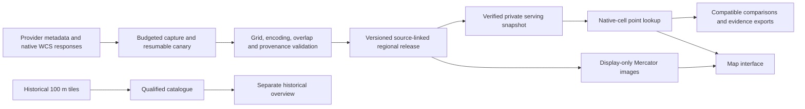

# Quiet UK project audit — 29 September 2026

Implementation follow-up: viewport-aware loading and fixes F03–F06 are now implemented; the sampled F09 text styles are also improved. See [the implementation and verification record](C:/Users/tanne/Desktop/quiet-uk-starter-v0.2/quiet-uk-starter/notes/VIEWPORT_LOADING_IMPLEMENTATION_2026-09-29.md). This report records the audit findings before that increment.

Quiet UK has a dependable foundation for exploring historical modelled transport noise. Its strongest work is the preservation of provider evidence, native analytical cells, explicit unknown states, immutable releases, and reproducible comparisons. The current product is useful for inspecting reported transport levels and comparing evidence at specific places. Its ability to identify genuinely quiet places remains limited by the source evidence, and the interface makes users do too much of the interpretation themselves.

The most valuable architectural optimization is to bound the browser's display workload. Backend point lookup is already fast for the installed release. There is no demonstrated reason to rewrite the backend, adopt microservices, add a spatial database to regional lookup, or replace the frontend framework. Fix the concrete integrity and presentation defects, load only the display data needed for the current view, and give users a clearer summary of a place.

This is an audit of the local working tree at commit **`d768cb11e898ed794e09d62e535be589d4600c75`**, including its existing uncommitted documentation changes. It is not a claim to have fetched the latest remote branch. The installed regional release inspected was **`pilot-ad6d31f2da1b0a754135`**: 50 cores, 450 source/indicator rasters, and a 5,000 km² Oxford–London rectangle. No application implementation was changed, data acquired, commit made, or deployment performed. New audit notes and ignored local evidence files are the only additions.

**The evidence supports a positive assessment of software integrity, with material limits on product usefulness and research fitness.**

The source-only suite passed **516 tests**, with three Windows capability skips and three intentionally deselected data checks. The optional data checks also passed **3/3**. `pip check` found no broken requirements. A bounded five-client HTTP smoke benchmark returned nine observations for every point, with median **44.0 ms** and p95 **83.5 ms** across 30 requests. This was warm local access to five example locations, not a national-capacity benchmark or the project's larger 200-request serving gate.

I confirmed the intended Heathrow behavior in the browser: Road/Night showed **37.4 dB(A)** and separately flagged aircraft at **75.4 dB(A)**. Rail/Night showed Unknown rather than a manufactured quiet value. A coordinate outside coverage, `55, -3`, remained explicitly unavailable. Comparison observations matched the corresponding point observations, and the historical-overview transition preserved the detailed source/time selection and comparison recipe on return.

I also reproduced several concrete implementation issues: shared-view coordinate rounding changed the native cell after reload; the two unknown legend swatches rendered the same pattern; important small text fell below a 4.5:1 contrast ratio; and regional raster validation accepted nonidentity scale metadata without decoding it. The last issue does **not** affect the installed release: all 450 inspected rasters have scale 1 and offset 0.

**Prioritized findings.** P1 means a major product or expansion constraint; P2 means a concrete correctness, usability, or dependability issue worth fixing in the next increments; P3 means maintainability work that should follow demonstrated needs. “Confirmed” includes directly reproduced behavior or a specific deterministic code path. Design judgments and scientific limitations are identified separately. There is no demonstrated P0 failure in the inspected release.

| ID / priority | Kind / confidence | Evidence | Impact and concrete remedy |
|---|---|---|---|
| F01 / P1 | Scaling tradeoff; high | [pilot.js](C:/Users/tanne/Desktop/quiet-uk-starter-v0.2/quiet-uk-starter/explorer/pilot.js:117) adds an image source and raster layer for every selected core and removes them all on indicator changes. PNG headers show **537,931,996 bytes** of decoded RGBA data for each 50-image source/indicator set. Road Lden is 16.75 MB compressed. | Display work grows with the entire selected area's coverage, even while inspecting a small neighborhood. First add viewport-aware core loading with an explicit limit and an overview image for low zoom. Retain the native analytical rasters and exact point APIs. Introduce display tiles only if measured results still require them. The RGBA figure is a payload calculation, not measured browser or GPU memory. |
| F02 / P1 | Product/evidence limitation; high | Exact core-cell scan: unknown night-time cells are **38.25% road**, **84.46% rail**, **97.57% aircraft**. Each denominator is 50 million cells in the downloaded rectangle, including non-land cells. [evidence_semantics.py](C:/Users/tanne/Desktop/quiet-uk-starter-v0.2/quiet-uk-starter/src/quiet_uk/evidence_semantics.py:16) correctly refuses to assign a quietness bound to these cells. | More coverage increases the number of places users can inspect; it does not resolve the quiet end. Keep expansion bounded, publish availability alongside area, and timebox provider clarification/domain evidence. Give users a place summary showing source evidence and missingness together. Do not fill unknown cells or manufacture a total-noise score. |
| F03 / P2 | Confirmed correctness defect; high | [pilot.js:29](C:/Users/tanne/Desktop/quiet-uk-starter-v0.2/quiet-uk-starter/explorer/pilot.js:29) serializes selected coordinates to six decimals. Browser and HTTP reproduction changed Road/Night from **35.3 to 35.0 dB(A)** after reload and native column **263 to 262**. | View links do not always reproduce the inspected observation. Preserve full numeric coordinates in the point recipe; round only displayed text and camera state. Test points just to either side of cell and core boundaries. Exact cell references are another option, but unnecessary for the immediate fix. |
| F04 / P2 | Confirmed code-path integrity gap; high; restart scenario not browser-reproduced | [pilot.js:106](C:/Users/tanne/Desktop/quiet-uk-starter-v0.2/quiet-uk-starter/explorer/pilot.js:106) accepts point data without comparing its `release_id` with the page manifest. The point route also lacks an expected-release parameter. Comparison requests perform both checks. | If a server restarts with a new release while an old tab stays open, point values can come from the new release while surrounding source metadata comes from the old manifest. Validate the point response identity and fail visibly on mismatch; optionally require the expected release in the API. Private snapshots protect a running server, not an already-open page across server replacement. |
| F05 / P2 | Confirmed display defect; high | [pilot.js:138](C:/Users/tanne/Desktop/quiet-uk-starter-v0.2/quiet-uk-starter/explorer/pilot.js:138) changes `backgroundColor`, while [pilot.css:1](C:/Users/tanne/Desktop/quiet-uk-starter-v0.2/quiet-uk-starter/explorer/pilot.css:1) supplies an opaque beige gradient to both swatches. Computed styles confirmed identical gradients. | The missing-cell legend does not match its blue-gray, opposite-direction raster pattern. Give each encoding its correct gradient/color/direction, or present a simpler common Unknown legend and put encoding detail in the inspector. Preserve the scientific distinction in exports. |
| F06 / P2 | Confirmed input-contract gap; high; current release unaffected | [source_pilot.py:293](C:/Users/tanne/Desktop/quiet-uk-starter-v0.2/quiet-uk-starter/src/quiet_uk/source_pilot.py:293) validates raw ranges without checking scale/offset. [lookup:641](C:/Users/tanne/Desktop/quiet-uk-starter-v0.2/quiet-uk-starter/src/quiet_uk/source_pilot.py:641) and display generation use the raw sample. A copied raster with scale 2 was accepted: raw **35.08** represents decoded **70.16**, but its QA minimum still reported 35. | A future provider encoding change could silently produce wrong levels while grid/range checks pass. The smallest safe fix is to require finite scale 1 and offset 0 for this supported regional encoding and record them in QA. Add explicit decoding only when a real product needs it. The historical raster decoder already handles scale/offset; its tests do not cover the separate regional path. |
| F07 / P2 | Confirmed provenance omission; high | [tiled_release.py:164](C:/Users/tanne/Desktop/quiet-uk-starter-v0.2/quiet-uk-starter/src/quiet_uk/tiled_release.py:164) builds the new manifest without a runtime record. The tiled canary also retains construction source and a dependency lock but no actual execution-runtime identity. The original regional parent does have a runtime record. | Parent runtime metadata does not establish the environment that produced the newer tiled display. Record actual Python, package, GDAL, PROJ, relevant projection-grid identity and construction-code hashes for each new build. Keep old releases frozen; record any reconstructed historical environment as an assessment rather than pretending it was captured at build time. |
| F08 / P2 | Confirmed update-detection gap; high | [launch_quiet_uk.ps1:12](C:/Users/tanne/Desktop/quiet-uk-starter-v0.2/quiet-uk-starter/scripts/launch_quiet_uk.ps1:12) and [api/app:97](C:/Users/tanne/Desktop/quiet-uk-starter-v0.2/quiet-uk-starter/src/quiet_uk/explorer_server.py:97) identify protocol/data generation, not running code. | A code update that retains interface version 2 and the same dataset can reuse an older backend process. Assets are read from the working tree, so newer frontend files may also meet older loaded backend code. Add a captured-at-start application build identity to health and compare it in the launcher; offer an explicit restart/stop path. Do not kill unrelated port owners. |
| F09 / P2 | Confirmed accessibility defect; high for sampled text | [pilot.css:1](C:/Users/tanne/Desktop/quiet-uk-starter-v0.2/quiet-uk-starter/explorer/pilot.css:1): important 11 px explanatory text is about **4.07:1** on the page background; 10 px credits about **3.61:1**; 9 px legend ticks about **4.25:1** on the nominal legend background. | Important qualifications are difficult to read. Darken critical text to at least 4.5:1 on its actual composed background and increase the smallest sizes. Keep the existing visible focus treatment and semantic controls. These calculations are targeted checks, not a complete WCAG conformance audit. |
| F10 / P2 | Observed UX tradeoff; high for layout, moderate for user impact | At 390×844, the map began around document y=731 and point evidence around y=1,238. The mobile comparison required horizontal scrolling; the second place was initially out of view. [pilot.css:12](C:/Users/tanne/Desktop/quiet-uk-starter-v0.2/quiet-uk-starter/explorer/pilot.css:12), [pilot.css:20](C:/Users/tanne/Desktop/quiet-uk-starter-v0.2/quiet-uk-starter/explorer/pilot.css:20). | Users must scroll extensively to connect controls, map, point evidence and comparison. Compact coverage/intro controls on mobile, put a selected-place summary close to the map, and make the active-indicator comparison readable without horizontal scrolling. Keep the full nine-indicator table available as detail. This is reviewer observation, not a new participant study. |
| F11 / P2 | Confirmed export completeness gap; high | [source_pilot.py:663](C:/Users/tanne/Desktop/quiet-uk-starter-v0.2/quiet-uk-starter/src/quiet_uk/source_pilot.py:663) returns the point record without the manifest's receiver height, nominal resolution, metric definitions, licence or attribution. The comparison CSV/JSON include more of this context. | A standalone point download needs additional release files to establish basic interpretation/citation context. Add a small versioned dataset-context object to the point JSON. State free-field/facade convention as unresolved unless authoritative evidence establishes it. Offer this compact evidence record prominently; retain the full data bundle for reproducibility. |
| F12 / P2 | Confirmed resource-bound gap; moderate local impact | [ExplorerServer:191](C:/Users/tanne/Desktop/quiet-uk-starter-v0.2/quiet-uk-starter/src/quiet_uk/explorer_server.py:191) inherits unrestricted request-thread creation. Raster readers and downloads are bounded, but request admission and geocoder waiters are not. Socket timeout does not bound time waiting on a Python lock. | Bursts can consume threads and queue work beyond useful client timeouts. Add modest admission limits and a bounded geocoder queue with a busy response; measure rejection/recovery behavior. Keep this proportional to a local product. No public-service capacity or demonstrated remote exploit is claimed. |
| F13 / P2 | Verification gap; high | [.github/workflows/verify.yml](C:/Users/tanne/Desktop/quiet-uk-starter-v0.2/quiet-uk-starter/.github/workflows/verify.yml:1) runs Python tests, not the regional frontend in a browser. The separate browser script targets the candidate viewer and depends on a local ignored installation and Windows Chrome path. The three `release_data` tests target historical candidate products. | Passing 516 tests did not detect the observed regional UI defects. Add a small portable regional browser smoke suite using synthetic/checked-in data: shared-point round trip, release mismatch, source warning, unknown legend, mobile comparison and failed dependency behavior. Keep full real-release performance/seam/export checks as explicit opt-in acceptance work. |
| F14 / P3 | Maintainability tradeoff; high | Regional code imports common serialization, hashing and PNG helpers through the historical explorer, and integrity exceptions through the much larger catalogue. Release discovery is duplicated between Python startup and PowerShell launcher. There are about 14,094 Python source lines across product, historical and experimental systems. | Move genuinely shared helpers and error types into a small dependency-light module when next touched; centralize installed-release discovery. Clarify which modules/commands are active, historical and experimental. Preserve historical tools and evidence. Avoid a broad folder reorganization or mass refactor merely to reduce line count. |

**The display workload, rather than point lookup, is the immediate optimization target.**

The regional rendering path attaches all 50 display images for the chosen source/indicator. Their decompressed RGBA payload is approximately **538 MB decimal / 513 MiB**, before accounting for browser representations, GPU allocations, basemap data or transient allocations while switching indicators. Road images transfer around 15.5–17.1 MB compressed per complete indicator set; aircraft images compress to about 1.7 MB, but expand to the same full dimensions. This explains why small HTTP image latency alone is not evidence of smooth mobile rendering.

The source data remain separate from these images. That separation makes a targeted optimization possible: use an overview derivative when viewing the whole region and add only intersecting core images, with a margin and a fixed resource cap, at detailed zoom. Reconcile visibility on camera changes and retain a bounded display cache. Check loading/failure state so the selected indicator cannot appear complete while only part of its overlay arrived. If core-sized images remain too expensive, cut the existing display derivative into ordinary raster tiles; that is a display change, not interpolation of analytical noise values.

Backend memory, disk and browser memory are separate budgets. The inspected release needs **5,392,580,404 bytes** for its private verified snapshot. Existing project evidence records approximately 47 s startup, a 742 MB ZIP and 70 s first-export preparation, totaling around 6.14 GB for snapshot plus ZIP. Those previous measurements were not rerun in this audit. I did verify the current snapshot's member-size total and let startup verify its published bytes and lineage.

The default 512-reader cache presently fits all 450 analytical rasters. A larger release may cross that threshold and lose its full warm-up advantage. A reduced-cap pressure run on the current data is appropriate, as the active roadmap already proposes. It must exercise dispersed points and comparisons; repeatedly inspecting one area would conceal reader churn. Keep the existing five-client p95 gates of 500 ms for points and 1,500 ms for comparisons. Do not claim a reduced-cache run proves the performance of a larger manifest or public service.

**The acquisition-to-export architecture is coherent; its active and historical branches should stay explicit.**



Acquisition preserves requests, responses, failure attempts and checksums. The newer canary has cumulative attempt/transfer budgets, disk reserve checks, non-overwriting evidence and resumable checkpoints. Native grid phase, extent, single-band structure, masks and observed ranges are checked. The tiled derivative reconstructs analytical lineage from parent records, publishes a new manifest and checks display joins. Publication and resource locks are materially useful protections, not gratuitous infrastructure.

The private serving snapshot hashes the bytes actually copied, isolates the running release from replacement of the acquisition directory, and bounds individual raster readers with exclusive access. ZIP creation is serialized, staged on disk and reused; at most two downloads proceed simultaneously. These are appropriate answers to the demonstrated integrity and export costs. Hard-linking mutable source files to avoid copying would weaken the isolation guarantee and is not a suitable quick optimization.

Regional lookup reads all nine observations from original rasters. Geometric reuse is confined to matching grids within a request. Comparison checks the release, coordinates, source/metric compatibility and declared periods; CSV exports preserve statuses and evidence and protect user-provided names against spreadsheet-formula interpretation. Aircraft numerical differences are withheld where the required comparison evidence is unavailable. That restriction is a deliberate contract decision, not a broken comparison feature.

The historical catalogue and candidate systems have substantial validation, ownership, publication and shutdown logic, and their tests passed. Their assumptions differ from the active regional evidence. Keep the historical overview visibly provisional and secondary. Do not feed its configured quiet-end bounds or the experimental road reconstructions into the new regional interpretation. The fact that historical raster decoding handles scale metadata correctly also illustrates why shared data contracts need explicit tests at the newer regional boundary.

**The product needs a clearer answer about a place, while preserving separate source evidence.**

The restrained palette, typography, map-label placement, coverage outline, radio controls, native dialog, explicit Unknown labels and focused point inspection form a consistent visual system. There is no reason to discard it. Desktop interaction was usable, and the historical transition did explain its different metric/construction. Keyboard-accessible point details and map-centre inspection are useful alternatives to a mouse-only map.

The hierarchy is less successful. A large introductory panel, coverage card, area selector, source controls, time controls and explanations precede the point evidence. The title of an inspected place becomes coordinates, even after a named search. A full source/time summary is folded away. Users principally want to understand a place; the source-first map asks them to assemble that answer. The retained P1 session report already provides limited supporting evidence for this concern, but it was stopped and does not establish a passed usability gate.

A small improvement would show three source rows for the active indicator immediately after selection: Road, Rail and Aircraft, each with its level/status and reference period. Keep aircraft visibly alongside road/rail, regardless of the colored layer, and state that these do not establish overall ambient sound. Preserve the chosen search-result label locally instead of using only coordinates. Name the current default more precisely, such as “Weighted annual average · Lden”; “Daily average” can sound like an ordinary day-specific reading despite the footnote explaining the penalties.

At 390 px the document did not overflow horizontally, which is good. However, the controls occupied most of the first screen and point evidence began well below it. The comparison table was technically scrollable but initially concealed the second place, frustrating the reason to open it. A compact active-indicator view or source cards can solve this without adding workflows. Detailed encoding explanations, the full nine-indicator table and provenance remain accessible in expandable sections.

The unknown swatch issue is a real styling bug, not a scientific correction. Both legend backgrounds used the same beige gradient despite distinct inline background colors. Critical explanatory text also needs more contrast and a larger minimum size. WCAG's normal-text criterion is [4.5:1](https://www.w3.org/WAI/WCAG22/Understanding/contrast-minimum.html); the sampled 11 px status/metric text was approximately 4.07:1. Transparent backgrounds and basemap composition require checking the actual rendered result, not just a palette file.


**The selected-point round trip has a precise reproduction.**

With Road/Night selected, search for latitude/longitude **`51.46671542367228, -0.4520146668103435`**. The original point API returns `35.29999923706055`, native row 968 and column 263 in `canary-r1c6-road-Lnight`. The UI displays 35.3 dB(A). The saved fragment changes the point to **`-0.452015,51.466715`**. Reload returns `35.040000915527344`, row 968 and column 262; the UI displays 35.0 dB(A). The adjacent native-cell polygon changes too.

This is a boundary-sensitive reproduction, not a claim that every saved point changes or that the model is accurate to the coordinate precision. It establishes that a view link can fail to reproduce the inspected evidence. Full precision is already retained in saved comparison coordinates and exact downloads, so consistent point serialization is a small fix.

**The scientific limitation is availability and interpretation, not nominal pixel size.**

The scan counted 50 million native core cells for each source/indicator. The exact availability results below concern the downloaded rectangle, including water and other non-land support. They are not percentages of authoritative source domain, England land or residents exposed.

| Source / indicator | Reported cells | Unknown cells | Unknown fraction |
|---|---:|---:|---:|
| Road Lden | 38,932,284 | 11,067,716 | 22.14% |
| Road Day | 36,673,703 | 13,326,297 | 26.65% |
| Road Night | 30,876,719 | 19,123,281 | 38.25% |
| Rail Lden | 11,217,391 | 38,782,609 | 77.57% |
| Rail Day | 7,806,577 | 42,193,423 | 84.39% |
| Rail Night | 7,772,204 | 42,227,796 | 84.46% |
| Aircraft Lden | 2,624,495 | 47,375,505 | 94.75% |
| Aircraft Day | 2,275,361 | 47,724,639 | 95.45% |
| Aircraft Night | 1,215,682 | 48,784,318 | 97.57% |

Road/rail unknown cells in this release are unmasked zero codes; aircraft unknown cells are raster-masked missing values. The code preserves that distinction. The high aircraft missing fraction does not imply aircraft-free territory. Download coverage, reported-value support and a confirmed model domain are different things.

Defra describes the road product as annual A-weighted noise on a 10 m grid at 4 m receptor height, with reporting cutoffs of 40 dB for most indicators and 35 dB at night. Its Lden includes evening/night penalties. The airport documentation states that actual thresholds vary with the competent authority's supplied data. These statements support the current cautious interpretation, but do not establish the meaning of every zero/missing cell. See [Defra road metadata](https://www.data.gov.uk/dataset/38b1444f-47a0-42ca-a358-0d145fcf7d5c/road-noise-all-metrics-england-round-4) and [Defra airport metadata](https://www.data.gov.uk/dataset/f962e5e8-8937-43f4-b692-4f030301571c/airport-noise-all-metrics-england-round-4).

The release's road and rail period is 2021; aircraft period remains unspecified in its captured evidence. Thus a current-looking map is not a current measurement. A 10 m grid is sampling support, not demonstrated 10 m acoustic accuracy, personal exposure or a house's facade reading. The native raster headers lack unit strings, so the unit/height interpretation relies on product metadata; that linkage belongs in compact exports too.

Energy-based arithmetic is appropriately distinguished from ordinary dB averaging in the acoustic library. The temporal library also explicitly distinguishes interval energy averages from piecewise-constant observations and refuses to derive distribution/event information from an annual raster. Annual levels do not recover loud-event counts, maxima, background percentiles or quiet intervals. The [CAA noise-metrics guidance](https://www.caa.co.uk/publication/download/24935) explains why equivalent levels, event metrics and background descriptors serve different questions. Adding fields or a temporal schema cannot fill those evidence gaps.

**What can currently be trusted is narrower than a general quietness promise.**

| Use | Assessment |
|---|---|
| Inspect an accepted provider model cell within this frozen regional release | Supported for exploration, with source, indicator, period, unknown-state and model limitations retained. |
| Compare two reported road/rail observations with matching evidence | Supported as a model comparison; the exact difference is not a validated perceptual or statistical significance claim. |
| Download original regional evidence and reconstruct its derivation | Designed for this and supported by hashes/source retention; this audit did not rerun the complete 450-image display reproduction and seam audit. |
| Select the quietest unknown place, estimate total ambient noise, certify a home/walk as quiet | Unsupported. Unknowns have no established quietness bound; sources do not establish a compatible total and omit other environmental sound. |
| Infer present-day traffic noise, aviation events or quiet minutes from these annual rasters | Unsupported. Reference periods and evidence types do not match those questions. |
| Explore historical geographic relationships using reported source values | Possible as a declared exploratory analysis, with censoring, spatial support, period matching and missingness handled explicitly. |
| Claim validated individual exposure or a causal relationship with house prices, health or stress | Not established. Independent validation, study-specific assignment, temporal matching, confounding and uncertainty work remain necessary. |
| Treat historical candidate screening as a certified quietness ranking | Unsupported; its provisional bounds and separate source qualifications remain limiting assumptions. |

For research, dropping all unknown cells would select a particular subset of mapped support, often related to source proximity and reporting rules. That can bias comparisons even when reported values are copied perfectly. Postcode-centroid joins, spatial autocorrelation, transport accessibility and urbanity also require explicit treatment. A street-level model cell should not silently become indoor exposure, a facade measurement or an individual's time-weighted dose.

An independent validation programme should start with a named claim, such as “this release can distinguish reported annual road-noise levels between comparable locations.” Seek source-compatible historical observations for 2021, matched indicator, receptor height and spatial support, with geographic holdouts and urban/rural/rail/airport/domain-edge strata. If compatible historical measurements cannot be obtained, current monitoring can assess contemporary usefulness, but it does not directly validate 2021 annual values. Short sound recordings are especially inadequate as a replacement for annual Lden.

Before evaluation, agree an error budget and comparison criterion with an acoustic specialist. Illustrative planning targets might be absolute mean bias no more than 3 dB, RMSE no more than 5 dB, and at least 80% correct ordering for compatible held-out pairs separated by at least 5 dB. These are proposed product acceptance targets, not regulatory standards or established fitness thresholds. Use enough independent locations and temporal support to report uncertainty around the results, publish stratum failures, and revise claims rather than tuning repeatedly on the final holdout. Unknown/domain classification needs separate authoritative evidence; numeric accuracy on reported cells cannot validate missingness semantics.

**Dependability and operation are suitable for a bounded local product, with some unfinished edges.**

The app binds loopback, has an allowlist of static/API/download routes, checks Host/Origin, validates bounded comparison input, rejects nonfinite coordinates and duplicate query parameters, avoids arbitrary file/proxy access and suppresses search/coordinate request logging. Invalid coordinates and unknown areas returned 400 in the probe; foreign Host/Origin returned 403. No arbitrary-code execution or remote exposure was demonstrated.

The server is still a local threaded HTTP implementation with unrestricted overall admission. It should not be exposed as a public service merely by changing its bind address. Before public hosting, make a concrete small deployment design around static display assets, protected/bounded analytical requests, a configured geocoder, resource limits and operational monitoring. Authentication should be driven by the intended access model; public, non-personal map data do not automatically require accounts. No public hosting work is needed to improve the current local product.

Place search is submitted explicitly, throttled and cached, with a configurable backend endpoint. This is much better than adding autocomplete calls. The [Nominatim policy](https://operations.osmfoundation.org/policies/nominatim/) limits public-service traffic to one request per second for the application and requires identification, attribution and the ability to switch services. Local per-process throttles are not an aggregate capacity plan for a widely distributed/public app. In this session an Oxford text search returned the handled “Place search is unavailable” message; coordinate lookup worked. The failure's upstream cause was not established. Add non-sensitive operational reason codes for search failure rather than guessing whether it was network, service policy, timeout or response format.

The private snapshot and on-demand ZIP have substantial but documented cost. Startup lacks a user-friendly disk estimate/progress surface, and forced termination can leave temporary data behind. A disk-space preflight, visible startup/export progress and explicit stop/restart operation would improve everyday dependability. Retain checksum verification; do not trade correct release pinning for a superficially fast launch.

The dependency declaration, Windows lock, pinned CI actions and cross-platform workflow are good foundations. Other platforms resolve allowed package ranges rather than replaying the Windows environment, and a dependency lock is not a record of the actual GDAL/PROJ execution environment for each derivative. This audit ran the existing Windows environment, not fresh installs on every platform or a vulnerability-scanner assessment. The workflow and recorded CI reports were inspected; their remote runs were not independently rerun.

**Five next actions would produce the most value.** Estimates are implementation ranges for one developer, excluding provider response times, acquisition duration and measurement fieldwork.

1. **Close the concrete integrity defects — roughly 0.5–1.5 days.** Preserve point precision, validate point release identity, correct unknown legend patterns and reject unsupported raster scale/offset. Add narrowly targeted regression checks at these boundaries. Existing analytical values, unknown meanings and frozen releases must remain unchanged.
2. **Bound the regional browser workload — roughly 2–4 days for core culling/overview and measurement.** Measure desktop and a phone viewport; add a resource cap and correct loading states. Run the planned reduced-reader-cache pressure experiment as well. Only introduce display tiling if the smaller change cannot satisfy the budget. Dependencies: existing release and baseline measurements; no new provider data.
3. **Make place evidence easier to understand — roughly 2–3 days.** Put the three active-indicator source rows together, retain aircraft prominence, improve text contrast, carry selected place labels, make the mobile comparison useful and make point downloads self-contained. Keep the full evidence table and original observations available. Do not resume participant recruitment automatically or make it an expansion prerequisite; the retained session was explicitly stopped.
4. **Improve execution provenance and local lifecycle — roughly 1–2 days.** Record each new build's actual native runtime, expose a captured running-code identity, add bounded request/search admission and provide clear startup/stop/restart status. Validate these changes using the existing release; avoid repairing historic provenance by inference.
5. **Advance the evidence and adjoining-coverage programme — 2–5 days of bounded desk/planning work, followed by data-dependent delivery.** Choose the next adjoining batch using provider bounds, serving/browser headroom, expected availability and storage/transfer budgets. In parallel, timebox domain/zero/aircraft-period clarification and specify independent validation for a named claim. Do not wait indefinitely for provider clarification to acquire useful reported coverage, and do not promote it to research exposure quality without the required evidence.

Stop or postpone additional below-threshold reconstructions, new quietness scores, automatic source totals, inferred event histories, generalized screening services, new research schemas without data, account systems and a large infrastructure rewrite. Keep experimental and historical evidence/tests available; freezing their feature development is more useful than deleting them. Wider UK integration should use each country's actual product contracts, not assume the England parser and periods apply unchanged.

**A bounded delivery sequence makes progress reviewable.**

| Increment | Deliverable | Completion criterion |
|---|---|---|
| A: correctness | Point-link/release fixes, legend correction and regional encoding guard | Original and restored native observations match at boundary cases; stale-release responses show no value; unsupported encoding is rejected; installed source hashes remain unchanged. |
| B: serving/display headroom | Bounded display loading and reduced-reader-cap measurements | Existing five-client API p95 gates retained; all selected/native observations and geometries unchanged; display requests/pixels bounded by viewport policy; desktop and phone initial loading, pan and indicator-switch timings recorded. Establish actual browser memory before adopting a memory gate. |
| C: place interpretation | Active-indicator source summary, readable text, compact complete export and usable mobile comparison | Heathrow source scope and aircraft evidence visible together; Unknown/outside cannot become a quiet value; normal text contrast at least 4.5:1; two saved places' active-indicator evidence can be read at 390 px without table panning. |
| D: adjoining release | Budgeted new cores using the existing verified pipeline | Exact overlaps/native grids, immutable lineage and source identities, explicit unknown counts, reproduced displays/joins, full enlarged-release serving acceptance, confirmed launcher build/release identity and recorded resource budget. |
| E: independent evidence | A named validation claim and matched evaluation dataset | Period/support compatibility recorded, holdouts and criteria specified before evaluation, error/ranking results and exclusions published; claims restricted to passing strata/questions. |

For increment B, set a provisional interaction target such as initial usable local display within 5 seconds after the HTTP server is ready and a warm active-layer switch within 1 second on the recorded reference device. These are proposed product targets, not achieved audit measurements. Revise them only with recorded device/network evidence. At low zoom, an overview derivative should avoid decoding every detailed core. At detailed zoom, the loaded core set must demonstrably follow the viewport and its margin.

**Verification record and limits.**

Inspected areas included project setup/CI/launcher; acquisition, budget capture and recovery; native grid/encoding and evidence interpretation; tiled publication/lineage/display seams; historical runner/catalogue/reporting; active regional snapshot/HTTP/lookup/comparison/export; acoustic and temporal utilities; experimental road-model and candidate/job systems; and both main explorer interfaces. Active user paths were traced in detail. Historical and experimental subsystems received targeted source review plus their test suites, rather than a claim to have independently validated every model or read every line.

Commands run from the project root:

```text
.venv\Scripts\python.exe -m pytest -q -rs --strict-markers
.venv\Scripts\python.exe -m pytest -q --run-release-checks -m release_data
.venv\Scripts\python.exe -m pip check
.venv\Scripts\python.exe scripts\29_serve_explorer.py --port 8767
.venv\Scripts\python.exe artifacts\project_audit_2026-09-29\probes.py
.venv\Scripts\python.exe artifacts\project_audit_2026-09-29\raster_probe.py
```

The default suite took **187.15 s**. The optional data suite took **3.00 s**. Skips concerned replacing an open SQLite database and two symlink-privilege cases on Windows. Runtime was Python **3.14.2**, Rasterio **1.5.1**, GDAL **3.12.4**, PROJ **9.8.1**, NumPy **2.5.2**, Requests **2.34.2**, PyProj **3.8.0**. The three optional data tests validate retained historical candidate products; they are not full current-regional release acceptance tests.

Browser checks used the Codex in-app browser at desktop 1440×900 and phone 390×844. They covered local coordinate search, Heathrow source/night/unknown behavior, outside coverage, precise point reload, named comparison loaded through a link, desktop/mobile comparison, point-details focus, and historical transition/return. Comparison recipes were provided through the URL so existing saved comparison storage was not overwritten. An Oxford text search showed the handled external-search failure state. A full keyboard-only journey, screen-reader session, actual Firefox/Safari/physical-phone test, offline basemap-failure simulation and participant study were not performed.

Saved evidence is in [the local audit directory](C:/Users/tanne/Desktop/quiet-uk-starter-v0.2/quiet-uk-starter/artifacts/project_audit_2026-09-29): [HTTP/image/round-trip probes](C:/Users/tanne/Desktop/quiet-uk-starter-v0.2/quiet-uk-starter/artifacts/project_audit_2026-09-29/probes.json), [raster metadata and counts](C:/Users/tanne/Desktop/quiet-uk-starter-v0.2/quiet-uk-starter/artifacts/project_audit_2026-09-29/raster-probe.json), [point JSON](C:/Users/tanne/Desktop/quiet-uk-starter-v0.2/quiet-uk-starter/artifacts/project_audit_2026-09-29/point.json), [comparison CSV](C:/Users/tanne/Desktop/quiet-uk-starter-v0.2/quiet-uk-starter/artifacts/project_audit_2026-09-29/comparison.csv), probe scripts and screenshots. This directory is ignored by Git and is local evidence, not a committed release artifact.

Primary external references were Defra's road/airport product descriptions, CAA CAP2598, W3C's contrast criterion and OSMF's Nominatim policy, linked beside their associated claims. Firecrawl's CLI was unavailable and its primary connector returned a credit error; built-in browsing supplied the references. Live Defra raster services were not called, provider zero/domain semantics were not resolved, full display reproduction/export/resource benchmarks were not repeated, and no independent sound measurements were available. A probe initially used the wrong fallback grid origin; it was corrected to read the saved provider grid description before the encoding case was accepted. All reported results use the corrected completed probe.

**Choose one next implementation task: make regional display loading follow the viewport, with an explicit resource budget.** It addresses the most concrete expansion bottleneck without disturbing analytical evidence, and produces measurable benefit for the existing app. Start with core culling plus a low-zoom overview, retain the native point APIs, and record browser results before moving to a larger data batch. The sharing/legend/encoding fixes are small correctness work that can accompany that increment; they do not justify a rewrite or another open-ended architecture project.
